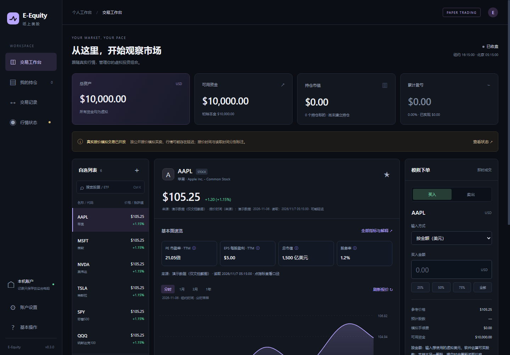

# E-Equity · Paper Trading

A Chinese-first US stock and ETF paper-trading app for beginners to learn basic operations such as buying and selling. Supports Windows and iPhone with accounts stored locally. Includes PE/EPS (TTM), market cap, PB, dividend yield and 52-week range, with plain-language explanations and beginner onboarding.

[中文](README.md) · [MIT license](LICENSE) · [Contributing](CONTRIBUTING.md)



## Features

- Windows Electron app and a local browser interface.
- Independent iPhone PWA with on-device IndexedDB accounts.
- Configurable virtual capital, fractional shares, watchlists, holdings and transaction history.
- Intraday samples and historical close charts, with provider time and fetch time shown separately.
- Core financial metrics with expandable details, provider/period labels and explicit missing-data states.
- ETF-specific assets/expense ratios, a four-step beginner guide and order-entry tips.
- New York trading dates, DST, holidays and early closes for 2026–2028.
- JSON account backup/restore and CSV transaction export.
- No brokerage account or API key required for the current public-quote adapter.

Quotes may be delayed. Simulated fills use a simplified quoted-price model; they do not reproduce brokerage execution. Fees, slippage, partial fills, dividends, splits, margin and options are not modeled.

## Run

Node.js 22.13+ and npm are required for development; Node.js 24 is recommended. Windows release installers include their runtime.

```sh
npm ci
npm run web
```

Open `http://127.0.0.1:17653`. Use `npm start` for Electron on Windows. Desktop and local web share one account store; run one server at a time. `EEQUITY_DATA_DIR` selects an isolated account directory.

The public source includes a manually maintained directory of 22 common symbols, with no quote dataset. To fetch a current larger directory and sync mobile assets:

```sh
npm run symbols:update
npm run sync:mobile
```

## iPhone and hosting

[Hosted demo](https://e-equity-iphone.outstandinghome1.chatgpt.site). In Safari, Share → Add to Home Screen. Accounts are local to the browser and origin; export a backup before clearing site data. Devices and different origins do not sync automatically.

```sh
npm ci --prefix iphone
npm run dev --prefix iphone
npm run build --prefix iphone
npm run start --prefix iphone
```

The mobile app uses Vinext/Vite and a Cloudflare Worker build. The first dev/build run creates a local configuration without a production Site identity. Use your own hosting configuration; see [deployment](docs/DEPLOYMENT.md).

## Check and package

```sh
npm run check
npm test
npm run test:mobile
npm run dist
```

Mobile tests require the mobile dependencies. Build the Windows installer on Windows; artifacts appear in `release/`. CI checks Windows/Linux with Node.js 22/24 and builds mobile. Version tags trigger a Windows release with checksums.

Tests cover accounting precision, concurrency, idempotency, backup integrity, market closures, quote failures, time encoding, DST, session dates, extended-hours exclusion, early closes, duplicates and chart positioning. Public tests and screenshots use synthetic data only. Regenerate screenshots with `npm run screenshots`.

## Data, privacy and license

Quotes are read from Nasdaq public website endpoints; directory updates come from Nasdaq Trader. Availability, latency and coverage are not guaranteed. Intraday samples are not complete trades or daily OHLC. Accounts stay on the device; quote requests transmit symbols, and hosting providers may retain ordinary access logs.

Project code is MIT-licensed. Third-party code, services and market data keep their own terms. The code license does not grant market-data redistribution rights. See [notices](THIRD_PARTY_NOTICES.md), [market data](docs/MARKET_DATA.md), [contributing](CONTRIBUTING.md) and [security](SECURITY.md).
