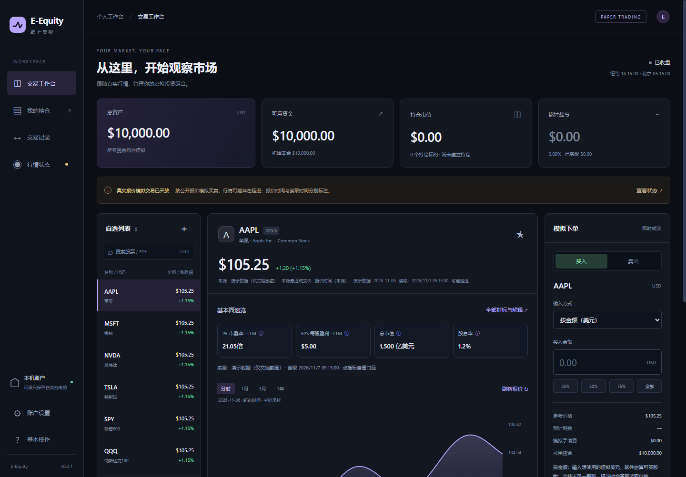
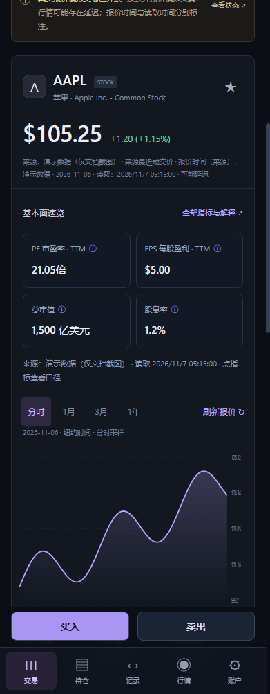

# 纸上美股 · E-Equity

中文美股与 ETF 模拟交易工具（新手向，支持买入、卖出等基础操作，包含 PE、EPS 等常用指标、指标解释与入门引导），支持 Windows 和 iPhone，本地保存账户。Chinese-first US stock and ETF paper trading.

[本次调试与核对报告](docs/DEBUG_AUDIT_2026-11-08.md) · [English](README.en.md) · [使用说明](使用说明.md) · [贡献指南](CONTRIBUTING.md) · [MIT 许可证](LICENSE)



## 能做什么

- Windows 桌面应用，以及同机浏览器界面。
- iPhone 网页应用，可在 Safari 中添加到主屏幕，独立运行。
- 自设虚拟本金、买入/卖出、小数股、自选、持仓与盈亏。
- 分时和历史收盘价图表，显示行情来源时间与读取时间。
- PE、EPS（TTM）、市值、PB、股息率与 52 周高低价；核心指标速览，点开查看来源、期间和解释。
- ETF 单独展示来源口径的基金资产、年费率与分配收益率。
- 四步新手入门、买卖操作提示；可收起，也可在账户设置重新打开。
- 按纽约交易日期处理正常交易时段、夏令时、节假日和提前收盘。
- 账户保存在设备上；通过 JSON 备份转移，交易记录可导出 CSV。
- 核心报价读取不需要券商账户或 API Key。

这是模拟交易软件。公开行情可能延迟，成交按读取到的报价简化计算，不保证与券商成交或行情完全一致。当前不模拟手续费、滑点、部分成交、分红、拆股、融资和期权；交易日历覆盖 2026–2028 年。

## 直接使用

Windows 用户可在仓库的 **Releases** 页面下载 `E-Equity-Setup-版本-x64.exe`，退出旧版后安装。现有账户可沿用；版本发布附带 SHA-256 校验值。

手机版在线体验：[纸上美股 iPhone](https://e-equity-iphone.outstandinghome1.chatgpt.site)。Safari 分享菜单 → 添加到主屏幕。账户保存在当前浏览器/网站的 IndexedDB 中；清理网站数据前请导出备份。不同部署网址和不同设备不会自动同步账户。



## 本地运行

需要 **Node.js 22.13+** 和 npm，建议使用 Node.js 24。Windows 安装包自带运行环境，普通用户不需要 Node.js。

```sh
npm ci
npm run web
```

浏览器打开 `http://127.0.0.1:17653`。Windows 桌面开发启动：

```sh
npm start
```

桌面版与本机网页版共用默认账户目录，不要同时启动两份服务。用 `EEQUITY_DATA_DIR` 可指定独立账户目录。

公开源码内附 **22 个常见标的的手工维护目录**，不含报价数据。可选更新完整目录，然后同步手机版：

```sh
npm run symbols:update
npm run sync:mobile
```

更新需要访问 Nasdaq Trader；目录范围随上游变化，接口不可用时不会凭空生成价格。

## 手机版开发与自托管

```sh
npm ci --prefix iphone
npm run dev --prefix iphone
```

打开终端打印的本地地址。构建与本地生产预览：

```sh
npm run build --prefix iphone
npm run start --prefix iphone
```

首次运行自动生成不含站点标识的本地配置。部署到自己的 Cloudflare/Sites 站点时使用自己的配置；原作者的站点身份没有包含在公开源码中。详见 [部署说明](docs/DEPLOYMENT.md)。

## 验证与打包

```sh
npm run check
npm test
npm run test:mobile
npm run dist
```

手机测试需要先完成 `npm ci --prefix iphone`。Windows 安装包输出到 `release/`；Windows 打包应在 Windows 上运行。首次安装或打包可能下载 Electron/NSIS。仓库提供跨平台自动测试、手机构建检查和标签触发的 Windows Release 工作流。

回归测试覆盖资金精度、并发订单、重复请求、备份恢复、休市、行情不可用、纽约时间编码、夏令时、交易日期、盘前盘后、提前收盘、重复点与图表横轴。公开测试使用合成行情。文档截图同样使用明确标记的演示行情，可用 `npm run screenshots` 重建，不展示个人账户。

## 数据与隐私

行情来自 Nasdaq 公开网页接口，目录更新来自 Nasdaq Trader。这些接口没有向本项目提供稳定性、实时性或完整覆盖承诺，可能受到地区、限流和格式变更影响。分时采样价不等于日线 OHLC，也不等于完整逐笔成交记录。

桌面账户保存在本机 E-Equity 数据目录，手机账户保存在浏览器 IndexedDB；行情请求会发送股票代码，公开网页托管方仍可能保留常规访问日志。账户、本金和交易账本不作为行情请求内容上传。

项目代码采用 MIT；第三方代码、服务和市场数据适用各自条款，代码许可证不授予行情数据再分发权。参见 [第三方说明](THIRD_PARTY_NOTICES.md) 和 [行情说明](docs/MARKET_DATA.md)。本项目不隶属于 Nasdaq、Yahoo 或券商。

## 贡献

欢迎提交问题、中文体验改进、行情适配器和测试。反馈行情问题时提供股票代码、纽约交易日期、来源时间、读取时间和可复现步骤，截图请遮挡个人信息。不要在 Issue 中上传账户备份或令牌。安全问题见 [SECURITY.md](SECURITY.md)。
